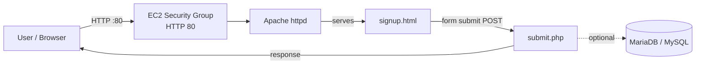

# PHP Project

A simple signup form built with HTML and PHP, hosted on an Apache web server running on an AWS EC2 instance (Amazon Linux). The user fills in the signup form, and the data is processed by `submit.php`.

---

## Introduction

This project demonstrates a basic static + dynamic web flow on a Linux server:

- `signup.html` collects the user's details (frontend)
- `submit.php` receives the form data and processes it (backend)
- Apache (`httpd`) serves the pages and passes PHP files to the PHP engine

**Files**

| File | Description |
|------|-------------|
| `signup.html` | Signup form (frontend) |
| `submit.php` | Receives and processes the form data (backend) |

---

## Architecture Diagram



---

## Requirements

- AWS EC2 instance (Amazon Linux) with Security Group inbound rule **HTTP (port 80)**
- Apache (`httpd`)
- PHP 8.x
- MariaDB / MySQL (only if the data is saved to a database)
- Git

---

## Installation

**1. Install the packages**

```bash
sudo yum update -y
sudo yum install httpd php git -y
```

If you use a database, also install:

```bash
sudo yum install mariadb105-server php-mysqlnd -y
```

**2. Clone the repository**

```bash
git clone https://github.com/Vishal32-stack/php_project.git
```

**3. Copy the files to the web root**

```bash
sudo cp -r php_project/* /var/www/html/
```

**4. Start Apache**

```bash
sudo systemctl start httpd
```

---

## Input

The user opens the signup page and fills in the form:

```
http://<EC2-PUBLIC-IP>/signup.html
```

The form data is sent to `submit.php` when the user clicks **Submit**.

---

## Output

After submitting the form, the result from `submit.php` is shown on the page.


---

## Conclusion

The signup form was deployed on an Apache + PHP server on AWS EC2. Users can open `signup.html`, submit their details, and see the result processed by `submit.php`.

---

## Author

**Vishal** — [GitHub: Vishal32-stack](https://github.com/Vishal32-stack)4d62-b2e1-3f356bd66527" />
